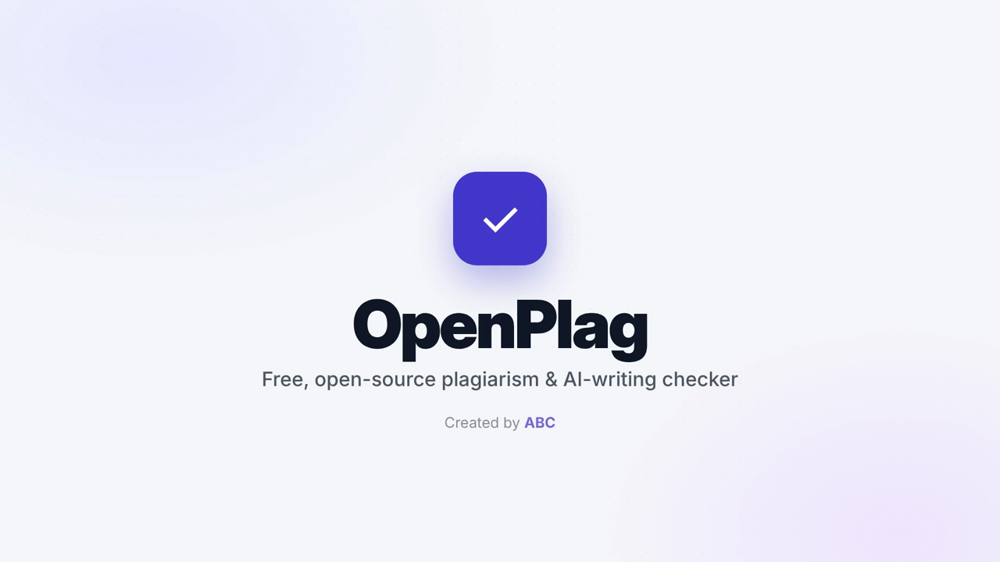
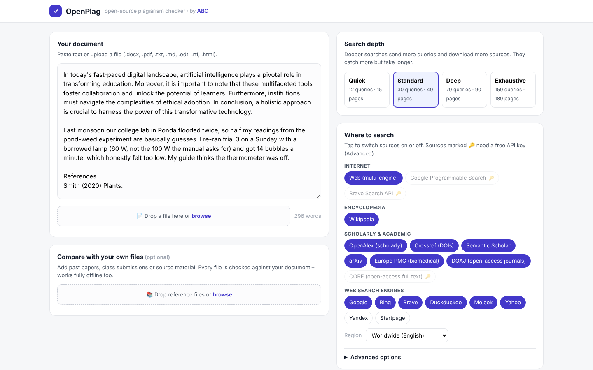
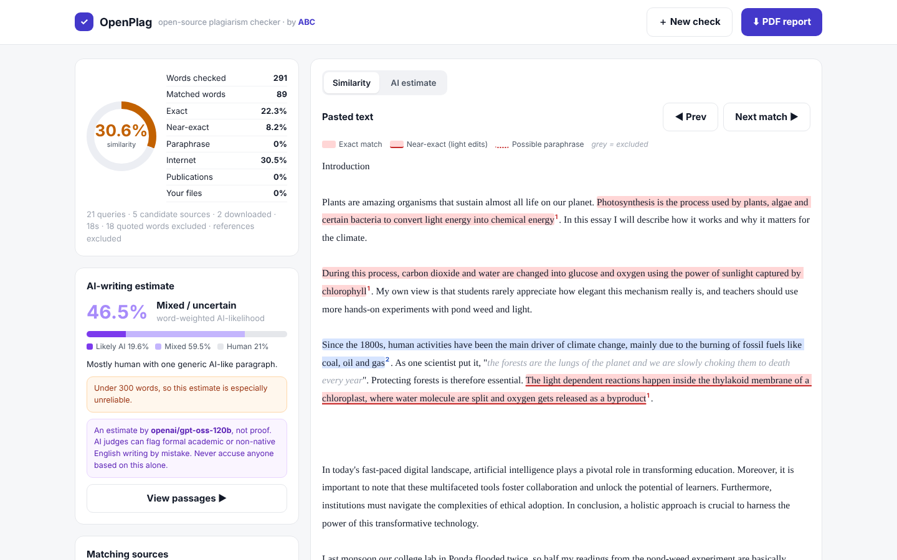
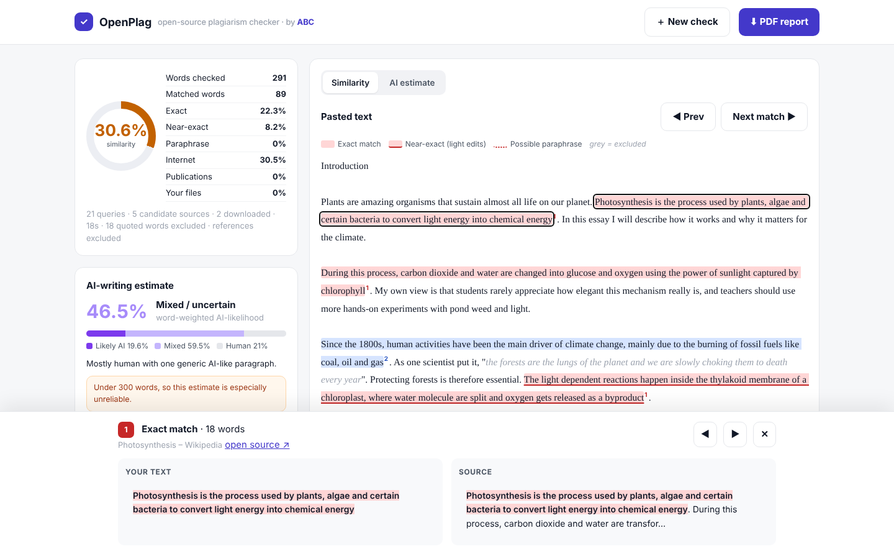
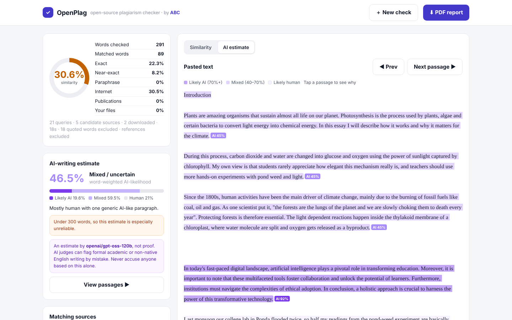

<p align="center"></p>

# OpenPlag – open-source plagiarism & AI-writing checker

Created by [ABC](https://www.linkedin.com/in/theabcguy/) ·
[](https://github.com/AdarshCB2001/openplag/actions/workflows/tests.yml) · MIT licence

OpenPlag checks an essay, assignment or research paper against the open web, scholarly databases, Wikipedia and your own files. It highlights every match, shows which source it came from, can estimate AI-written passages, and exports a PDF report. It runs on **your own computer**, so your documents stay private.

▶️ 

https://github.com/user-attachments/assets/c636c700-56c1-4485-aba3-a758a5ad70d0


## Quick start (Windows)

1. Install **Python 3.10+** from [python.org](https://www.python.org/downloads/) and tick *"Add python.exe to PATH"*.
2. Download this repo (**Code → Download ZIP**) and unzip it.
3. Double-click **`run.bat`**. The first run sets everything up in about a minute, then opens the app at http://127.0.0.1:8000.
4. *(Optional)* Add free API keys in the app for CORE, Brave, Google or Groq (AI check).

On macOS or Linux, run `./run.sh` instead. To try it out, use [`docs/sample/test-document.txt`](docs/sample/test-document.txt). It contains public-domain text that should be flagged, a passage written in a typical AI style, and an original personal paragraph.

## Screenshots

| Check form | Results |
|---|---|
|  |  |
| **Side-by-side match detail** | **AI-writing estimate** |
|  |  |

<sub>These screenshots were taken with the offline test data from `tests/`.</sub>

## What it searches

| Source group | What you get | Key needed? |
|---|---|---|
| **Web, multi-engine** (`ddgs`): Google, Bing, Brave, DuckDuckGo, Mojeek, Yahoo, Yandex, Startpage | Web pages. The top hits are downloaded and compared in full. | No |
| **Wikipedia** | Full article text | No |
| **OpenAlex** (250M+ works) | Abstracts and open-access PDFs | No |
| **Crossref** (150M+ DOIs) | Abstracts | No |
| **Semantic Scholar** | Abstracts and open-access PDFs | No (a key raises the rate limit) |
| **arXiv** | Abstracts and PDFs | No |
| **Europe PMC** | Biomedical abstracts and open-access PDFs | No |
| **DOAJ** | Open-access journal articles | No |
| **CORE** | Full text of millions of open-access papers | Free key: https://core.ac.uk/services/api |
| **Google Programmable Search** | Official Google results (100 free queries a day) | Free key and engine ID: https://programmablesearchengine.google.com |
| **Brave Search API** | Official Brave results | Free tier: https://brave.com/search/api |
| **Your files** | Past papers, classmates' submissions and source material, compared word by word | No |

## AI-writing estimate (optional, uses Groq)

Turn on **"Estimate AI-written text"** and paste a free Groq API key (https://console.groq.com/keys). The ↻ button loads the models available to your key; `openai/gpt-oss-120b` is the default.

- The document is split into passages of about 40–280 words, and the references section is skipped. Passages are sent to Groq in batches of about 900 words.
- For each passage, the model returns an **AI-likelihood (0–100%)** and the reasons it gave. OpenPlag adds local style signals: sentence-length variation, vocabulary variety and AI-typical phrases ("delve", "pivotal", "Furthermore"…).
- The results show an overall word-weighted score, how much of the text looks likely AI, mixed or likely human, and an **AI estimate** tab that shades each passage. Tap a passage to see why it was scored that way. The PDF report gets an "AI-writing estimate" section.
- Groq's free tier is rate-limited (about 30 requests and roughly 8,000 tokens a minute on the main models). OpenPlag waits and retries automatically, so a long paper can take a minute or two.
- You can run it on its own: switch off every search source and keep only the AI check.

⚠️ **This is an estimate, not proof.** Every AI detector, including commercial ones, gives false positives. Formal academic writing and non-native English are flagged more often. Results under 300 words are especially unreliable. Never use this as the only evidence against anyone.

## How detection works

1. **Query building.** The document is split into sentences. Distinctive windows of about 11 words are chosen, spread evenly across the text. The number of queries depends on the mode: Quick 12, Standard 30, Deep 70, Exhaustive 150.
2. **Search.** All enabled sources are searched in parallel, with a rate limiter for each provider. Duplicate URLs are merged.
3. **Ranking and download.** Candidates are ranked by how many queries found them and by how much their snippet overlaps the document. The top pages and PDFs are downloaded, and their main text is extracted with trafilatura or pypdf.
4. **Matching**, in three layers:
   - **Exact:** shared runs of 5-word shingles, merged across small gaps, with a minimum of 8 words by default.
   - **Near-exact:** whole sentences that are 82% or more similar (rapidfuzz). This catches light edits and swapped words.
   - **Paraphrase** (optional): sentence-embedding similarity of 0.80 or more, using a multilingual MiniLM model.
5. **Attribution.** Each word is credited to only one source, the largest one first, so the overall percentage never double-counts. You can exclude a source to recalculate the score immediately.
6. **Exclusions.** Text in quotation marks and the References or Bibliography section can be excluded. You can also list domains to ignore.

## Run it on your computer (Windows, macOS or Linux)

You need **Python 3.10 or newer** (https://www.python.org/downloads/; on Windows, tick "Add Python to PATH").

- **Windows:** double-click `run.bat`
- **macOS/Linux:** run `./run.sh`

The first run installs the dependencies, which takes about a minute. The app then opens in your browser at http://127.0.0.1:8000.

Manual setup:
```bash
python -m venv .venv
.venv/Scripts/activate        # Windows  (macOS/Linux: source .venv/bin/activate)
pip install -r requirements.txt
python app.py
```

Optional paraphrase detection (a large download, about 2 GB with PyTorch):
```bash
pip install -r requirements-semantic.txt
```

## Put it online

The project ships with a `Dockerfile` and a `render.yaml`:

- **Render.com:** push this folder to a GitHub repo, then choose New → Blueprint and pick the repo.
- **Any Docker host:** `docker build -t openplag . && docker run -p 8000:8000 openplag`

API keys can be set on the server as environment variables, so users don't need their own: `GOOGLE_CSE_KEY`, `GOOGLE_CSE_CX`, `BRAVE_API_KEY`, `CORE_API_KEY`, `S2_API_KEY`, `CONTACT_EMAIL`, `GROQ_API_KEY`.

⚠️ There is no login. If you host it publicly, anyone with the link can use your API quotas. Add authentication, or keep the link private.

## Honest limits

- **It is not Turnitin.** Turnitin also searches paywalled journals, books and a private archive of student papers. OpenPlag sees only public web pages, open scholarly records and the files you give it.
- **Free web search is rate-limited.** Search engines may throttle or block heavy use, especially from cloud servers. The log shows when a provider pauses. Adding a Google or Brave key makes web search much more reliable.
- **Some pages can't be downloaded** (paywalls, bot protection). Those sources are compared using only their snippet or abstract and are labelled "snippet".
- **A similarity percentage is not a verdict.** Matches can be properly cited quotes, common phrases or the author's own earlier work, so always review them.

## Project layout

```
app.py                 FastAPI server and API
plagcheck/search.py    query building and the 11 search providers
plagcheck/fetch.py     page and PDF download, text extraction, 7-day disk cache
plagcheck/match.py     matching engine (exact / near / paraphrase) and scoring
plagcheck/pipeline.py  orchestration and progress reporting
plagcheck/report.py    PDF report (ReportLab)
plagcheck/aicheck.py   AI-writing estimate (Groq LLM judge + style signals)
plagcheck/extract.py   .docx / .pdf / .odt / .rtf / .html / .txt to text
static/index.html      the web interface
tests/                 offline tests: test_engine.py, test_pipeline.py, test_ai.py (network mocked)
docs/demo/             demo video (MP4) and thumbnail
docs/screenshots/      app screenshots
docs/sample/           sample test document
tools/video/           source code for the demo video and its original music
.github/workflows/     CI: runs the offline tests on every push
```

## Running the tests

```bash
pip install -r requirements.txt
python tests/test_engine.py && python tests/test_pipeline.py && python tests/test_ai.py
```

All network calls are mocked, so the tests run offline.

License: MIT · Created by [ABC](https://www.linkedin.com/in/theabcguy/)
